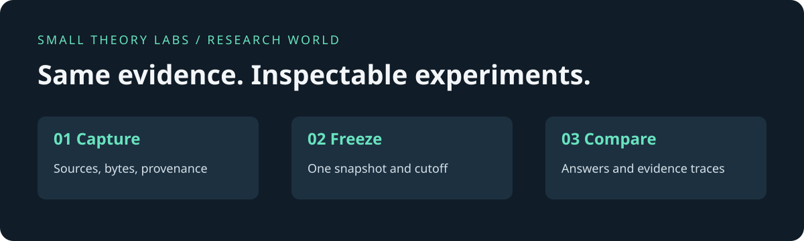

# Research World

**The web changes. Your experiment shouldn't.**

Capture web evidence with an LLM. Freeze a research world. Compare agents against the same sources—with a trace of what each agent actually read.

[Quickstart](#try-it) · [Connect an agent](docs/agents.md) · [Methodology](docs/methodology.md) · [Validity study](docs/validity-study.md) · [Contribute](CONTRIBUTING.md)



Built by [Anirudh Agarwal](https://github.com/Anirudh279) at **Small Theory Labs**. MIT licensed. **Development alpha**: useful for building and inspecting experiments; not a validated model leaderboard.

## Why this exists

Two agents can answer the same question and still take different tests. Search rankings move. Pages change. One agent sees a correction; the other sees an old article. A better answer may reflect better evidence rather than better reasoning.

Research World makes the evidence an explicit experimental input:

1. **Capture:** an LLM plans research, searches, selects sources and archives pages. You do not need an existing archive.
2. **Freeze:** a content-addressed snapshot binds source bytes and a cutoff.
3. **Compare:** agents search, open, find and follow within that snapshot. Answers retain their source-access traces and exact quotations.
4. **Inspect:** compare answers and evidence use. Export a portable challenge when you have rights to share its sources.

Use it to test a research prompt, debug a citation failure, examine what happens when evidence changes, or build the collection foundation for prospective forecasting studies.

## Try it

**Python 3.11+ · macOS or Linux**

```sh
git clone https://github.com/Anirudh279/research-world.git
cd research-world
python3 -m venv .venv
. .venv/bin/activate
python -m pip install -e .
python examples/reproduce.py data/first-world
```

Open `data/first-world/comparison.html`. This verifies a saved comparison by two real native agents on a **fictional, project-authored source**. No API key is needed to inspect this example. It rechecks saved evidence; it does not generate new answers or establish which model is better.

Then run your own research:

```sh
web-research-sim serve
```

Open **http://127.0.0.1:8000**. Choose a question, configure a model route, collect sources and freeze a snapshot. Run both agents on that snapshot.

| Your route | What you supply | Start here |
|---|---|---|
| Native subscription agent | An authenticated local Codex or Claude Code client; it keeps its own authentication and uses MCP tools | [Agent guide](docs/agents.md) |
| Hosted APIs | Model key, search key and an explicit reviewed cost policy | [Setup](docs/setup.md) · [Costs](docs/costs.txt) |
| Docker | Docker Compose; configure either model route | `cp .env.example .env` then `docker compose up --build` |

Actual research uses an LLM. The key-free example is an inspection path, not a replacement for the model. Native subscriptions and API credits are separate; native inference remains outside the server's spending cap. Hosted adapters exist for OpenAI, Anthropic, Brave and Scrappa, but live verification is incomplete.

## Built for agent developers

- **HTTP + Python + MCP:** use your own agent loop or the supplied collection/research workflows.
- **Durable sessions:** tool observations, failed calls and submissions remain inspectable. Reusing operation keys supports recovery without silently repeating work.
- **Frozen tools:** missing evidence returns an archive miss, not a live-web fallback.
- **Originals and provenance:** preserve original bytes, extracted text, hashes and capture times.
- **Portable worlds:** export/import snapshots and standalone comparison reports.
- **Explicit limits:** request reservations and conservative hosted cost admission; unknown charges stay unknown.

[Python integration](docs/python-agent.txt) · [MCP contract](docs/mcp.txt) · [Storage](docs/storage-and-recovery.txt) · [Container deployment](docs/deployment.txt)

## What the evidence says

Our bounded validity study used one question, two original pages and two prompt strategies. Independent reconstruction reproduced the reported metrics. Controlled tests exercised future-evidence exclusion, source removal, contradiction, search order and corruption.

It also exposed failures: four original trials submitted no answer after invalid searches. We clarified the tool contract; both follow-up baseline trials completed. A blinded **model reviewer** checked claim support. This was not human validation, and it does not establish strategy superiority.

Read [the study and its limitations](docs/validity-study.md). The public repository includes a reproducible synthetic example; private study records and publisher archives are not distributed here.

## What this measures—and what it does not

| Can inspect | Cannot infer from it alone |
|---|---|
| Which archived passages a session received | All knowledge available to the model |
| Whether quotations match observed text | Whether every answer claim is correct |
| Whether runs use the same snapshot | Whether the whole agent is network-isolated |
| Tool calls and recorded reservations | Unknown native subscription costs |
| Captured evidence available at a cutoff | Historical pages we never captured |

This is an environment for constructing research benchmarks. It is not a complete copy of the internet, a browser task benchmark, or an established forecasting leaderboard. The product is an alpha; independent clean-host deployment, broader collection fidelity and live hosted-provider verification remain open.

## Help build the standard for inspectable research experiments

Start with a small contribution that another person can reproduce:

- Reproduce the example on a clean machine and report the exact environment.
- Add a self-authored challenge with a source correction, contradiction or missing fact.
- Connect an agent and share a trace, declared budget and failure analysis.
- Improve extraction with a minimal redistributable failing fixture.

[Contribution guide](CONTRIBUTING.md) · [Roadmap](docs/roadmap.md) · [Open an issue](https://github.com/Anirudh279/research-world/issues/new/choose)

If you use Research World in research, see [CITATION.cff](CITATION.cff). Please report the commit, snapshot digest and agent configuration—not just a score.

## Development

```sh
python -m pip install uv==0.7.4
uv sync --frozen
uv run --frozen pytest -q
```

Default tests use controlled fixtures. Dedicated CI jobs exercise containers and a local storage emulator without paid credentials. Passing them does not establish real provider compatibility.

## License

Code is [MIT](LICENSE). Project-authored synthetic starter text is CC0-1.0. Captured publisher content and dependencies retain their own rights; the code license does not grant permission to redistribute an archive. See [third-party notices](THIRD_PARTY_NOTICES.txt).
